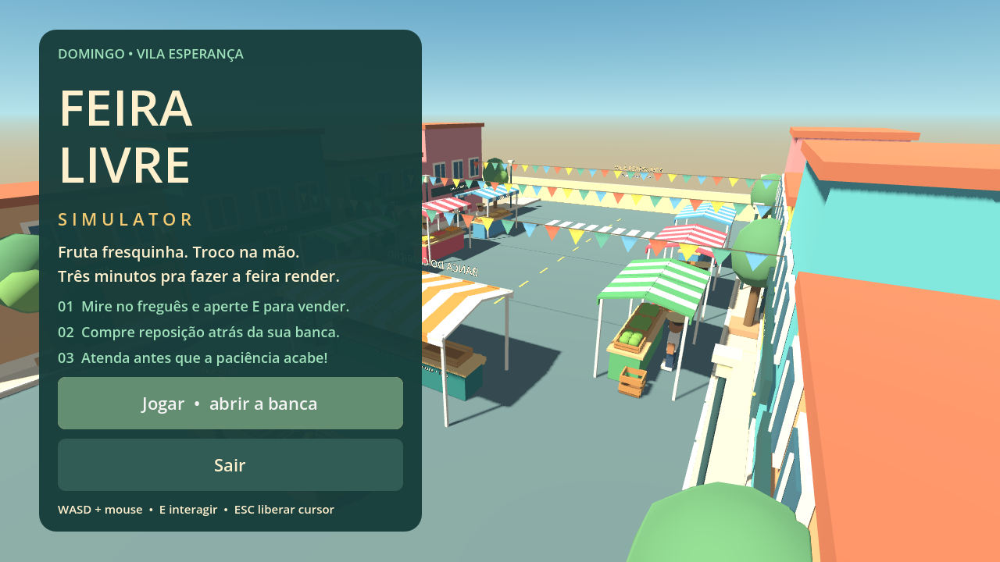
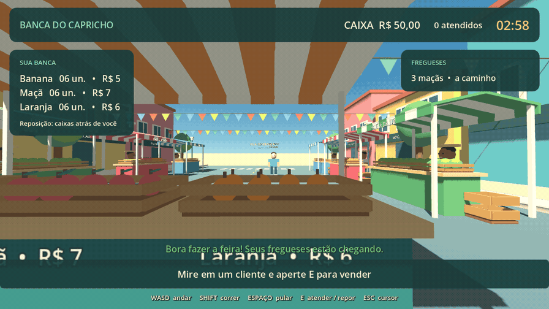
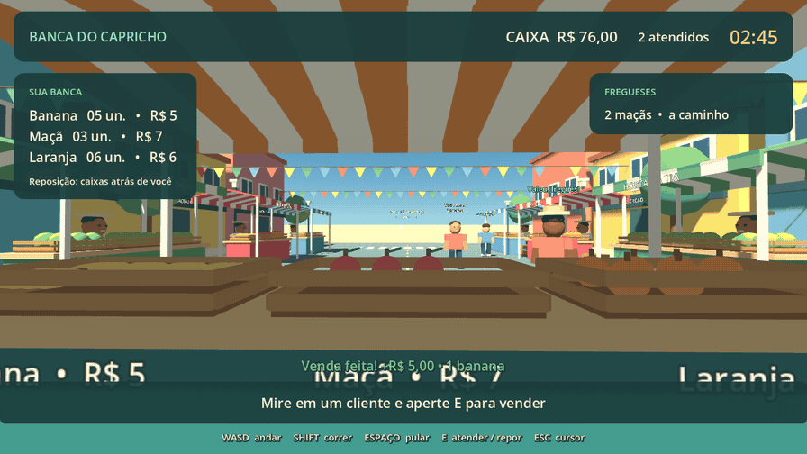

<div align="center">

# 🍌 Feira Livre Simulator

**Fruta fresquinha. Troco na mão. Três minutos para fazer a feira render.**

[](https://godotengine.org/)
[](scripts/)
[](https://github.com/henriquerochars/feira-livre-simulator/actions/workflows/tests.yml)
[](LICENSE)

[Como jogar](#-como-jogar) · [Instalação](#-rode-localmente) · [Demonstrações](#-o-jogo-em-movimento) · [Contribuir](CONTRIBUTING.md)



</div>

> **Projeto de teste desenvolvido utilizando o Astra.** Este experimento explora a criação de um jogo 3D funcional com assistência de IA: implementação, arte procedural, testes e documentação. É um protótipo open source para estudar, jogar e modificar.

Você acaba de abrir a **Banca do Capricho**, na Vila Esperança. Os fregueses querem frutas, o estoque não é infinito e ninguém gosta de esperar. Atenda os pedidos, reinvista na reposição e tente fechar a manhã com lucro — tudo em uma partida de **3 minutos**.

*A colorful, first-person Brazilian street-market simulator. An experimental project built using Astra, with procedural 3D assets, offline gameplay, and a fully playable three-minute loop. The game and primary documentation are in Brazilian Portuguese.*

## 🎬 O jogo em movimento

### “Me vê umas maçãs!”

Clientes chegam, mostram o pedido e aguardam atendimento. Mire no freguês e aperte **E**: o estoque diminui e o pagamento entra no caixa.



### Comprar, repor, voltar ao balcão

As caixas ficam atrás da banca. Uma compra adiciona **6 unidades** e desconta o custo do caixa na hora.



<sub>Capturas reais do renderizador do Godot. O agente executa uma demonstração automatizada com movimento, eventos de mouse e tecla E; vendas e reposição passam pelo raycast e pela lógica normal do jogo. Não são animações conceituais. O roteiro reproduzível está em <a href="tools/record_demo.gd">tools/record_demo.gd</a>.</sub>

## ✨ O que já funciona

| Sistema | No protótipo |
| --- | --- |
| Primeira pessoa | Andar, olhar, correr, pular, gravidade e colisões |
| Feira procedural | Barracas listradas, fachadas, bandeirinhas, árvores, caixas e frutas |
| Sua banca | Bananas, maçãs e laranjas, com estoque e preços próprios |
| Fregueses | Chegada, pedidos aleatórios, paciência, pagamento e saída |
| Economia | Caixa, receita, reposição paga e lucro líquido |
| Partidas | 180 segundos, resultados, avaliação e reinício |
| Interface | Menu, HUD, pedidos e instruções em português brasileiro |
| Áudio | Efeitos de transação sintetizados por código |

**Sem assets externos, plugins, contas ou serviços online.** Geometria, materiais, personagens, frutas e sons são gerados no próprio projeto.

## 🚀 Rode localmente

### Requisitos

- **Godot 4.7.2 estável**, edição padrão — não precisa da versão .NET.
- Uma sessão gráfica para jogar.
- **Python 3** somente para executar a suíte de testes.
- **FFmpeg** somente para recriar os GIFs.

O jogo foi validado graficamente no **macOS / Apple M4 Pro**, com o renderizador **Compatibility**. O CI também verifica a execução headless no Linux. Outras versões do Godot 4 e execução gráfica em outros sistemas ainda não foram validadas.

### 1. Clone

```sh
git clone https://github.com/henriquerochars/feira-livre-simulator.git
cd feira-livre-simulator
```

### 2. Instale o Godot

Baixe a edição padrão no [site oficial do Godot](https://godotengine.org/download/). No macOS, mova `Godot.app` para `/Applications`.

### 3. Abra a banca

```sh
sh tools/godot.sh
```

O script procura Godot na pasta local `.tools/`, em `/Applications` ou como `godot` / `godot4` no PATH. O executável do motor **não está incluído neste repositório**. Para usar outra instalação:

```sh
GODOT_BIN="/caminho/para/Godot" sh tools/godot.sh
```

Ou importe **`project.godot`** no Godot e pressione **F5**. Para abrir pelo terminal no editor:

```sh
sh tools/godot.sh --editor
```

## 🎮 Como jogar

1. Clique em **Jogar • abrir a banca**. Você começa com **R$ 50** e **6 unidades de cada fruta**.
2. Espere os clientes nas três marcas em frente ao balcão. O pedido e o tempo de espera aparecem sobre a cabeça e no HUD.
3. Aproxime-se, mire no corpo do cliente e pressione **E**. O pedido inteiro é entregue automaticamente, se houver estoque.
4. Quando precisar, vire-se para as caixas atrás da banca. Mire em uma delas e pressione **E** para comprar mais 6 unidades.
5. Ao fim dos três minutos, confira o lucro, os atendimentos e os clientes perdidos. Clique em **Mais uma feira!** para recomeçar.

| Tecla | Ação |
| --- | --- |
| **W A S D** | Andar |
| **Mouse** | Olhar |
| **Shift** | Correr |
| **Espaço** | Pular |
| **E** | Atender / comprar reposição |
| **Escape** | Liberar ou capturar o cursor |

> O relógio continua correndo com o cursor livre. Priorize clientes com pouca paciência e evite comprar estoque que não conseguirá vender antes do fechamento.

## 💰 A conta da feira

| Fruta | Venda por unidade | Reposição de 6 unidades |
| --- | ---: | ---: |
| 🍌 Banana | R$ 5 | R$ 12 |
| 🍎 Maçã | R$ 7 | R$ 18 |
| 🍊 Laranja | R$ 6 | R$ 15 |

```text
Lucro líquido = receita de vendas − gastos com reposição
Caixa final   = R$ 50 + lucro líquido
```

O estoque inicial é gratuito. Frutas que sobram não viram dinheiro. Clientes que desistem ou continuam com pedidos pendentes no encerramento contam como perdidos.

| Avaliação | Meta |
| --- | --- |
| Aprendiz da feira | Avaliação inicial |
| Tá pegando o jeito! | Lucro ≥ R$ 40 |
| Feirante de primeira! | Lucro ≥ R$ 100 e 9 atendimentos |
| Lenda da feira! | Lucro ≥ R$ 180 e 15 atendimentos |

## 🧪 Testes e validação

```sh
python3 tools/test.py
```

A suíte executa a importação do projeto, **55 verificações de comportamento** e smoke tests limitados do menu e da partida. Ela falha diante de erros de script, avisos de objetos não liberados ou timeout, mesmo se o Godot retornar código zero.

- **Economia:** estoque, venda, falta de estoque, reposição, falta de dinheiro e conciliação de caixa.
- **Clientes:** pedidos válidos, chegada, atendimento único, desistência e saída.
- **Integração:** raycasts, tecla E, colisão com o balcão, gravidade, corrida e pulo.
- **Partida:** limite de três pedidos, prazo de 180 segundos, resultados e reinício.
- **Sessão completa:** simulação determinística com clientes, reposição e fechamento.

Na validação local, a simulação com semente `12345` fechou **29 vendas**, receita de **R$ 360**, despesas de **R$ 135** e lucro de **R$ 225**. As mesmas verificações também foram executadas com renderização gráfica; menu, gameplay, reposição e resultados foram inspecionados visualmente.

Para gerar as quatro capturas de validação:

```sh
sh tools/godot.sh --script res://tests/test_game.gd -- --visual
```

Logs e capturas temporárias ficam em `artifacts/` e não entram no Git. Veja o [workflow de testes](.github/workflows/tests.yml) e as [execuções do CI](https://github.com/henriquerochars/feira-livre-simulator/actions).

## 🧱 Organização do projeto

```text
feira-livre-simulator/
├── project.godot                # configuração e ponto de entrada
├── scenes/                     # cena principal e cliente reutilizável
├── scripts/
│   ├── main.gd                 # montagem, menu e transições
│   ├── player_controller.gd    # movimento e câmera
│   ├── interaction_system.gd   # mira e interação
│   ├── catalog.gd              # frutas, preços e formatação
│   ├── inventory_manager.gd    # estoque
│   ├── economy_manager.gd      # caixa, receita e despesas
│   ├── game_session_manager.gd # transações, tempo e resultados
│   ├── customer_controller.gd  # comportamento de cada freguês
│   ├── customer_spawner.gd     # geração de clientes e vagas
│   ├── market_art.gd           # primitivas e objetos procedurais
│   ├── market_manager.gd       # cenário e pontos de reposição
│   └── ...                     # HUD, resultados, estilo e áudio
├── tests/                      # testes de comportamento e integração
├── tools/                      # execução, testes e gravação dos GIFs
├── docs/media/                 # imagens e GIFs públicos do README
├── .github/                    # CI, issues e template de PR
├── AGENTS.md                   # convenções para agentes de desenvolvimento
├── CONTRIBUTING.md             # como colaborar
└── LICENSE                     # MIT
```

## 📹 Reproduza os GIFs

Com Godot e FFmpeg instalados, em uma sessão gráfica:

```sh
python3 tools/make_gifs.py
```

O comando abre o jogo, executa duas vendas e uma reposição usando eventos reais de entrada, captura os frames e converte os clipes para GIF. A semente fixa torna os pedidos reproduzíveis. As gravações brutas ficam em `artifacts/recordings/`; apenas os GIFs otimizados e a capa entram em `docs/media/`.

## 🤝 Contribua

Encontrou um bug ou quer melhorar a feira? Abra uma [issue](https://github.com/henriquerochars/feira-livre-simulator/issues/new/choose) ou envie um PR. Leia o [guia de contribuição](CONTRIBUTING.md) e as [convenções de desenvolvimento](AGENTS.md).

Boas próximas contribuições: acessibilidade da interface, ajustes de sensação de movimento, mais detalhes procedurais e testes em outras plataformas. Mantenha o projeto pequeno, offline e fácil de executar.

## 🛠️ Escopo e limitações

Este é um **projeto de teste utilizando o Astra**, não um lançamento comercial. O protótipo tem um mapa, uma banca funcional, três frutas e até três pedidos simultâneos. Bancas vizinhas são decorativas. Clientes seguem caminhos simples e podem atravessar outros NPCs. O atendimento entrega o pedido inteiro; não há manipulação física de frutas ou troco manual.

Não há salvamento, multiplayer, contas, ranking online ou pacote `.app` exportado. Para jogar, use o Godot.

## 📄 Licença e créditos

Criado por **[Henrique Rocha Serrano](https://github.com/henriquerochars)** como um experimento utilizando o **Astra**.

Código e mídia original deste repositório sob a [licença MIT](LICENSE). O [Godot Engine](https://godotengine.org/license/) é um projeto independente, com sua própria licença. O executável do motor não é redistribuído aqui.
